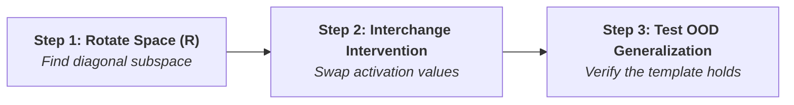
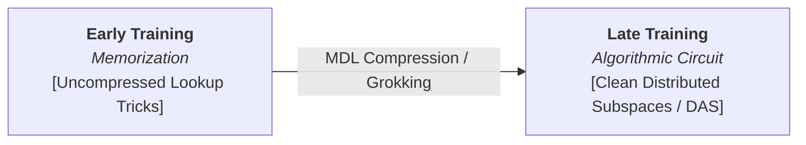

---
###### Admissible Transformations & The Representational Constraint

> *"The relativity of this analysis to the choice $\mathcal{C}$ of admissible transformations is significant... Some have forcefully argued that proper implementation demands representational equivalence: computational explanations fundamentally cite representational properties of a system—'no computation without representation' (Fodor, 1975)... In our framework, this can be understood as a constraint on the space $\mathcal{I}_\tau$ of allowable operations on the low-level system. Perhaps such interventionals should be restricted to meaningful operations on suitable representational vehicles... More generally, the concern arises that the resulting set $\mathcal{I}_\tau$ may be unnatural, complex, or otherwise inapt. Would we want to say, for instance, that $M^*$ implements the XNOR circuit $M$?"*

* In Section 3.2 of the framework, showing that a neural network implements an algorithm requires finding a coordinate translation $\tau$ from a class of allowable transformations $\mathcal{C}$ mapping low-level activations to high-level variables.
* ==If any arbitrary, hyper-complex mathematical transformation is allowed in $\mathcal{C}$, almost any neural network can be forced to look like it implements any algorithm.==
* **Fodor's Constraint (1975)**: 
		- If a system is just shuffling bits or moving voltages around, that is merely **physics or syntax**. 
		- To say a human brain or an AI neural network is performing a **computation** (e.g., checking if two shapes match), ==🟢its internal physical states must correspond to **representational vehicles** that carry actual content== (such as the concept of _"sameness"_ or _"left-pair identity"_). Without internal representations, there is no computation—just raw, uninterpreted cause and effect.
* **Application to Causal Abstraction**: Interventions in $\mathcal{I}_\tau$ cannot be arbitrary mathematical tricks—they must target <mark style="background: #FF5582A6;">meaningful representational vehicles</mark> (e.g., concepts like "is equal" or "pair identity").
* In the $M^*$ vs. XNOR circuit $M$ example, forcing a match requires **unnatural, complex, and gerrymandered** interventional operations.

---

###### Core Taxonomy: Representational Vehicles vs. Representational Content

> *"Is representational vehicle = subspace, and representational content = concept?"*

* Vehicle and content are two sides of the same coin, but cognitive science and mechanistic interpretability maintain a precise distinction between the physical/mathematical container and the semantic meaning.

| Term | Metaphor | Definition in Interpretability / DAS | Example in Hierarchical Equality Task |
| :--- | :--- | :--- | :--- |
| **Representational Vehicle** | The "Car" | Physical or mathematical structure inside the system carrying information (e.g., wire, neuron, or **linear subspace**). | A specific $k$-dimensional rotated direction $Y_1$ in activation space. |
| **Representational Content** | The "Passenger" | High-level meaning, concept, rule, or symbolic variable represented by the vehicle. | The concept *"are the two left shapes identical?"* ($B_1 = 1$). |

* **Representational Vehicle = Subspace**: In deep neural networks with **distributed representations**, concepts are not localized in single neurons. The vehicle is a **direction or linear subspace** in activation space. DAS applies an orthogonal rotation matrix $R$ to align this subspace with coordinate axes.
* **Representational Content = Concept**: The semantic idea being computed (e.g., *"sameness"*, *"left pair equality"* $B_1$, or *"global relation match"* $C$).
* **Causal Link**: A subspace acquires content strictly through its **causal role**. If intervening on a subspace alters downstream behavior according to a symbolic rule, that subspace is the true vehicle for that concept.

---

###### Computational Explanation & The Role of Representation

> *"Because implementation plays into an account of computational explanation, our answer to these questions should be informed by what we want from a theory of computational explanation in cognitive science and in machine learning. As often emphasized, computational explanations typically invoke representations; indeed, claims of implementation are often thought to be tightly bound up with representational claims. It will therefore be helpful to clarify what we take the role of representation in computational explanations to be."*

* We don't study implementation just for linear algebra—we study it to provide **valid scientific explanations** of cognition and AI.
* **Explanation Requires Meaning**: Saying a model computes means it actively computes over internal concepts (e.g., *"is pair 1 equal to pair 2?"*).
* **Implementation & Representation are Inseparable**: Claiming a network implements a logic circuit implies specific internal directions physically stand for those logical concepts.
* **Formal Definition**: A computational explanation is a **causal explanation in an interventionist framework**:
  * **Causal Model Construal**: High-level algorithm is formalized as a structural causal model with explicit variables.
  * **Counterfactual Interventions**: Low-level states implement the algorithm because ==intervening on low-level states produces the exact counterfactual outputs predicted by high-level variable manipulations.==
  * **Predictive Generalization**: A good computational explanation must compactly predict system competence across ==🔴novel, out-of-distribution inputs.==

---

###### Semantically Laden Computation & Functions Over Values

> *"Computational models, in addition to realizing an abstract (causal) structure, are assumed to be semantically laden: computation happens over some representational objects, which in turn allows us to speak of functions being computed over some values, and the like."*

- Raw Causal Wiring (Syntax)  +  Semantic Content (Meaning)  =  Genuine Computational Explanation.
* **Meaning Beyond Pure Mechanics**: Raw cause-and-effect wiring isn't enough. For physical mechanics to qualify as **computation**, internal states must carry **semantic content** (meaning) about entities or logic.
* **"Realizing an abstract (causal) structure"**: The structural syntax (variable $A$ causes $B$, which causes $C$).
* **"Semantically laden"**: Internal states are filled with meaning—they stand for concepts outside their physical values.
* **"Functions computed over values"**: Because internal subspace $B_1$ carries the content "are the left shapes identical?", we can describe the network as evaluating the function $\text{Equal}(\text{Shape}_1, \text{Shape}_2)$ rather than executing arbitrary matrix multiplications.
* **Examples**:
  * **Turing Machine**: Marks `111` on tape are physically ink, but treated as computation because `111` represents the number 3.
  * **Neural Network**: Hidden activations are floating-point numbers, but when aligned via rotation, form a representational vehicle whose content is *"these two stimuli share the same expression"*.

---

###### Vehicles as Causal Interventional Operations

> *"When would we want to say that variable $B_1$ implicitly 'takes on' value 1 in circuit $M^*$? What representational vehicle in $M^*$ can have content 'the two shapes are the same'? It cannot be simply a set of points in state space. Instead, we are compelled to think of vehicles in terms of the corresponding operations (viz. interventionals) on the system that essentially put it into the state of representing that content. There is then a sense in which the circuit—when processing inputs $A_1 = 1$ and $A_2 = 1$—does represent the relation of sameness, insofar as performing the operation does not change the circuit's behavior. Setting $B_1$ to 0, by contrast, overrides the effect of inputs $A_1$ and $A_2$, producing the expected change in output as a function of $A_3$ and $A_4$. The relevant interventional induces the desired representational state in an indirect, but causally meaningful, way."*

* In simple circuits, a vehicle is a single node or cluster of points. In complex distributed circuits ($M^*$), no clean cluster of points corresponds to "sameness".
* **The Solution**: Define representational vehicles in terms of **interventional operations**:
$$\text{Vehicle} \equiv \text{The specific causal manipulation that induces the concept state in the system}$$

| Mode | Operation | Result & Proof |
| :--- | :--- | :--- |
| **1. Passive Alignment** | Inputs $A_1=1, A_2=1$ (identical). Apply intervention $B_1=1$. | Output **remains unchanged**. Proves unperturbed state already naturally encodes "sameness". |
| **2. Active Counterfactual Override** | Inputs $A_1=1, A_2=1$ (identical). Force intervention $B_1=0$. | **Overrides** inputs $A_1, A_2$, forcing downstream logic to output expected false result. |

* ==Even if a concept is not localized in a single neuron or static cluster, it is genuinely represented if a specific causal intervention induces that state in a predictable counterfactual manner.==

---

###### Ideal Models, Glitchy Implementations & Misrepresentation

> *"Imagine that a neural network $N^*$ was nearly, but not perfectly, abstracted(-under-translation) by the circuit $M$. Suppose some pair of inputs that are not the same causes the rest of $N^*$ to assume the state it ordinarily does when they are the same. This, in turn, leads it to output the wrong label. It is natural to say that (the relevant part of) $N^*$ is misrepresenting these two inputs as being the same, and perhaps even that this misrepresentation helps explain why $N^*$ outputs the wrong label. Such an interpretation depends on showing that $M$ is an apt abstraction of $N^*$. The question is pressing because $M$ is not perfectly implemented by it. Would not some $M^*$ that does perfectly abstract $N^*$ be a better candidate? For instance, $M^*$ might involve a variable $B_2^*$ whose structural function is just like that for $B_2$, with the exception of this one input on which it agrees with $N^*$. According to the theory of implementation on offer here, $N^*$ implements $M^*$, and not (strictly speaking) $M$. Despite this, one might insist that ascribing to $N^*$ the computation $M$ is somehow more explanatory... when it comes to intermediate representations—where significance is (at least largely) determined by causal role—the possibility of misrepresentation seems to depend on the possibility of prioritizing some (possibly less accurate) causal abstractions over others."*

* **The Dilemma**: A network $N^*$ solves the equality task 99% of the time, mirroring clean circuit $M$. On one non-identical shape pair, it glitches, triggers internal "SAME" state, and outputs the wrong answer.
* **The Paradox**: Mathematically, $N^*$ perfectly implements messy circuit $M^*$ (which includes the glitch). Under $M^*$, the network didn't make an "error"—it followed its glitchy rule perfectly! If we only accept 100% exact math matches ($M^*$), the idea of **misrepresentation or error disappears**.
* **Why we pick clean model $M$ over messy $M^*$**:
  1. **Normative Goal**: The system/agent treats the output as an error to be corrected; $M$ acts as the **ideal blueprint**.
  2. **Simplicity & MDL**: ==🔴Clean algorithm $M$ is simpler. Assuming a simple, compact algorithm ($M$) gives vastly better **predictive power** for unseen inputs than overfitting a complex circuit ($M^*$) to every glitch.==

---
###### The Triviality Specter & Sutter et al. (2025)’s Theorem

> *"As one might expect, the translations needed to witness this existence claim look rather gerrymandered, and the mappings themselves must be quite complex. In their experimental investigations, Sutter et al. (2025) found it strikingly difficult to identify the relevant space of interventionals (even though they knew from first principles of their existence). For instance, the interventionals could not even be learned using multi-layered reversible neural networks. What are we to make of this continued specter of triviality? Should we restrict $\mathcal{C}$ to some narrower class of transformations? Maybe further restrictions on allowable vehicles would help rule out some gerrymandered cases, say, by appeal to a metaphysically weighty notion of 'naturalness'... An alternative would be to appeal to an independently motivated account of representational content..."*

* **Sutter et al. (2025) Theorem**: If coordinate translations $\mathcal{C}$ are unconstrained (allowing arbitrary non-linear functions), ==every neural network can be mathematically shown to implement every algorithm.==
* **Gerrymandered Mappings**: Forcing an arbitrary network to match an arbitrary algorithm requires wildly complex, unnatural translations.
* **Optimization Failure**: Sutter et al. tried finding these theoretical mappings using multi-layer reversible networks. Despite proofs guaranteeing their existence, secondary networks **could not learn or find them in practice**.
* **Fixing Triviality**:
  1. **Restrict Transformation Class $\mathcal{C}$**: ==🔵Limit translations to simple geometric transformations—specifically **linear orthogonal rotations (DAS)**==.
  2. **Demand Independent Representational Content**: Require internal variables to correspond to independently verified concepts.

---
###### Linear Rotations (DAS) vs. Non-Linear Mappings

> *"Does using non-linear functions between low level networks and high level algorithms lead to finding fake alignments?"*

* Yes. Unconstrained non-linear functions allow mathematical warping that creates **fake, gerrymandered alignments**.
#### The Interpretability Goldilocks Zone

| **Too Strict** *(No Coordinate Translation)*                          | **Just Right (DAS)** *(Linear Rotations / DAS)*                      | **Too Permissive** *(Arbitrary Non-Linear)*               |
| :----------------------------------------------------------------------- | :---------------------------------------------------------------------- | :----------------------------------------------------------- |
| Fails to find distributed concepts; requires single-neuron localization. | Rotates space to find diagonal linear vectors; preserves true geometry. | Warps space to force fake matches with any target algorithm. |

* **Why Linear Rotations Are Gold Standard**: Orthogonal rotation matrices $R$ re-orient coordinate axes without stretching, squishing, or warping vector geometry. ==🔴Because linear rotations cannot arbitrarily distort space, discovering a causal match via DAS guarantees the alignment reflects **genuine internal structure**.==

---
###### Limits of Pure Interventionism & Internal Model Principles

> *"Such appeals would need to rest on something other than a pure interventionist account of causal explanation, with its primary focus on manipulation, control, and answers to what-if-things-had-been-different questions (e.g., Woodward 2003...)... Triviality results like the one established by Sutter et al. (2025) have a similar flavor to a series of results on 'internal model principles' (see, e.g., Conant and Ashby 1970...). Each formulated somewhat differently, these results are often offered in a positive light: as long as an agent demonstrates a particular sort of behavior, we know without any further ado that there must be some corresponding internal structure within the agent that facilitates the behavior... None of these results by themselves put any restriction on the mapping needed to witness the structural claim; nor do they say anything about how any of the relevant states are manifested in the agent, much less how anything is represented by the agent."*

* **Interventionist Account (Woodward 2003)**: Defines explanation purely as establishing interventional control ("what-if-things-had-been-different").
* **The Limitation**: ==🟣If control is the *only* criterion, even gerrymandered mappings are "impeccable" because they provide a working control map.==
* **Internal Model Principles (Conant & Ashby 1970)**: *"Every good regulator of a system must be a model of that system."*
  * **Positive view**: Guarantees any working agent has *some* internal causal structure.
  * **Limitation**: Existence theorems do not restrict the mapping—they can't tell us if structure is a natural representational vehicle or a gerrymandered artifact.
---
###### Constructive View of Triviality: A Blueprint for Control

> *"One might try to interpret results like those of Sutter et al. (2025) in a similarly constructive manner, but with further constructive content. The proof of the theorem might be seen as a recipe for constructing the relevant interventionals and mappings, such that control relative to any suitable algorithm is guaranteed. This might not always be feasible in practice, but the theorem tells us it always is in principle. At the very least, they explicate the precise respect in which any given algorithm is implemented in a neural network."*

* Rather than viewing triviality purely as a threat, we can treat the proof **constructively**:
  1. **Recipe for Control**: Details exact mathematical steps required to construct coordinate mappings and interventional sets guaranteeing control.
  2. **In Principle vs. In Practice**: While learning these mappings with secondary networks is practically infeasible, the theorem guarantees existence in principle.
  3. **Explicating Implementation**: Defines the exact mathematical transformation required to treat a low-level network as implementing a high-level algorithm.
---
###### Minimal Implementation vs. Deep Scientific Explanation

> *"Because abstraction-under-translation (relative to any $\mathcal{C}$ at all) facilitates in-principle manipulation and control, we are inclined to accept it as a suitable analysis of computational implementation. With Chalmers (2011a,b) and others, we contend that it is useful to define such a minimal notion. Still, this does not mean that every (true) claim of computational implementation will be deeply explanatory. There is a widely held intuition that, for some algorithms and some neural networks, the network does not really implement the algorithm... To the extent that we are interested in explaining one well-circumscribed behavior—one precisely delineated input-output mapping, for one single artifact at a specific time—it is hard to imagine how we could demand more than the kind of causal explanation that abstraction-under-translation furnishes. However, we are rarely, if ever, in this situation. We (almost) never want to understand one specific, behaviorally-circumscribed artifact at one specific time."*

* **Minimal Implementation (Chalmers 2011)**: ==🟡Any mathematical mapping enabling counterfactual control qualifies as minimal implementation.==
* **Scientific Explanation**: Requires more than minimal control—==🔴it must capture how the system operates across varied conditions.==

### Explanatory Duality

|                 | **Static Snapshot** *(Single Artifact / Frozen Time)* | **Dynamic Science** *(Generalization)*             |
| :-------------- | :------------------------------------------------------- | :---------------------------------------------------- |
| **Goal**        | Explain one fixed dataset at one time.                   | Predict behavior on novel out-of-distribution inputs. |
| **Requirement** | Minimal causal control.                                  | —                                                     |
| **Status**      | Complex, gerrymandered mappings suffice.                 | ==🟢Requires natural, un-gerrymandered templates.==   |

---
###### Benchmark Limitations & Task Circumscription

> *"No one, however, believes that any existing benchmark comprehensively circumscribes the intended tasks, or even that the tasks are all perfectly well-defined."*

* **Existing Benchmark**: Standard evaluation test sets (MMLU, GSM8K, GLUE).
* **Comprehensively Circumscribes**: ==🔴Completely covers the domain of a capability.==
* **Core Insight**: Passing a benchmark **does not equal algorithmic mastery**. ==🟠Benchmarks sample narrow input slices.== Models can achieve high benchmark scores via superficial heuristics or memorized shortcuts. To verify true capability, we must look inside using **causal abstraction (DAS)** to confirm a genuine internal circuit.
---
###### Out-of-Distribution (OOD) Generalization & Algorithmic Templates

> *"What if the causal variable is only realized on the narrow distribution of inputs used for localization? This question of whether a causal analysis generalizes to 'out-of-distribution' inputs becomes more important as supervised localization tools ==🔵become more powerful and therefore more capable of overfitting== (Wu et al., 2023; Huang et al., 2024; Sutter et al., 2025). In cases where we can show that a model has internalized a concrete algorithm for solving a task (or performing well on a benchmark), this might lend some confidence that the model will generalize to instances of the task beyond what we have observed. Employing only linear translations, Huang et al. (2025) show that localization of causally meaningful variables helps predict model behavior on variants of a task that could flummox other prediction methods. ==🟡Roughly, models get it right in cases where they have correctly matched the new input to an existing algorithmic template==, just as in the hierarchical equality case imagined above."*

* **Overfitting Risk**: Supervised localization tools (DAS) are powerful search algorithms that risk locating causal variables working *only on the narrow dataset used during localization*.
* **Algorithmic Templates**: When linear localization confirms an internal **algorithmic template** (reusable circuit), it grants confidence the model hasn't merely memorized answers.
* **Empirical Proof (Huang et al. 2025)**: Using linear translations, localizing causally meaningful variables predicts model behavior on novel task variants.
  * *Example*: Switching currency labels from Canadian dollars to Turkish lira is incidental to number comparison. If the model routes Turkish lira inputs into its internal "number-comparison" template, it generalizes successfully.
---
###### Empirical Grounding: How DAS Works in Practice

> *"Is this what DAS basically does?"*

* **Yes, exactly.** Distributed Alignment Search (DAS) is the empirical tool created to verify whether a model uses a genuine **algorithmic template**.

1. **Linear Rotation Matrix ($R$)**: Re-aligns coordinate axes via orthogonal matrix $R$ to ==🔴isolate distributed concept subspaces without warping activation geometry.==
2. **Interchange Interventions**: Rotates base and counterfactual hidden states into $R$-coordinate space, swaps activation values in the target subspace, and rotates back to measure counterfactual output.
3. **Generalization Verification**: ==🔵Checks if the localized linear subspace maintains its causal role when tested on novel, out-of-distribution task variants.==
---
###### "Foreign" vs. "Native" Representational Vehicles

> *"If the representational vehicles witnessing an implementation are sufficiently foreign to the way the system itself works, there will be little hope of this."*

* **"This"**: Refers to **out-of-distribution (OOD) generalization and behavior prediction**.
* ==🔴"Foreign" Vehicles: Mappings constructed using unnatural, overly complex, or gerrymandered mathematical transformations.==
* **"Native" Vehicles**: Representational structures aligning naturally with the network's intrinsic activation geometry (e.g., linear subspaces discovered via orthogonal rotations).
* ==If an interpretability tool relies on an artificial mathematical wrapper ("foreign vehicle"), it reflects the analyst's complex math rather than the model's actual processing. Novel inputs won't route through that artificial wrapper, rendering the mapping useless for predicting real-world behavior.==
---
###### Beyond Flat Subspaces: Complex Representational Geometries

> *"We will likely also need to contend with more complex representational geometries naturally induced by models (Karkada et al., 2026; Wurgaft et al., 2026), and presumably by brains as well (Ivanova et al., 2022)."*

* **Linear Subspaces as First Approximations**: Linear rotations (DAS) assume concepts are stored in flat, straight-line vector subspaces. ==🔴While effective and safe against triviality, linear subspaces are a simplified first approximation.==
* **Curved Manifolds & Natural Geometries**: ==🔴AI models and biological brains naturally format complex concepts into curved, non-linear geometric structures (curved manifolds, multi-dimensional geometric shells).==
* ==🔴**Future Challenge**: Interpretability methods must expand beyond flat linear rotations to accommodate **naturally induced non-linear geometries**—while maintaining strict mathematical constraints to avoid falling back into gerrymandered triviality.==
---
###### Synthesis: Compression (MDL), Grokking, and Learning Dynamics

> *"Some have argued that we are justified in making representational claims (and presumably also claims of computational implementation) only when the putative representations play a pivotal role in a model’s generalization behavior (e.g., Shea 2007)... Computational explanation, in particular, enjoys a privileged place in this effort. When we hypothesize specific algorithms that a model or agent might be using to solve a problem, we tend to focus on simple, compact, and general algorithms that solve the task efficiently... ==🟡Humans and artificial neural networks alike have been shown to learn and generalize in a way consistent with 'minimum description length' or 'compression' principles== (e.g., Feldman 2016; Deletang et al. 2024; Mingard et al. 2025); and compression is tightly related to presence of algorithmically meaningful causal variables (Wendong et al., 2025). ==🔴There is even suggestive evidence that emergence of generalization abilities coincides with (and is plausibly due to) the emergence of algorithmic structure in the hidden layers of neural networks, whereby particularized ('memorized') solutions to problems are gradually replaced with algorithmic methods that generalize in the right ways (e.g., Nanda et al. 2023a)..."*==

* **Generalization as Representation Benchmark (Shea 2007)**: ==🟢We are justified in claiming a model possesses internal representations only when those structures actively drive its generalization behavior across novel scenarios.==
* **Compression & Minimum Description Length (MDL)**: Both biological minds and neural networks optimize for **MDL**—==🔵compressing complex training data into compact algorithmic rules (Occam's razor).==
* **Grokking & Algorithmic Transition (Nanda et al. 2023a)**:
  * ==🔴Early training: Networks rely on uncompressed, memorized lookup tricks for specific inputs.==
  * ==🔴Late training ("grokking"): Networks transition away from memorized heuristics, constructing **clean, compressed algorithmic circuits** in hidden layers.==
  * ==🔴This internal transition directly triggers the sudden emergence of out-of-distribution generalization.==

* ==Static cause-and-effect mappings are insufficient on their own. Genuine representations are compressed, algorithmically meaningful causal structures that arise naturally through learning and empower physical systems to generalize robustly across the open world.==
