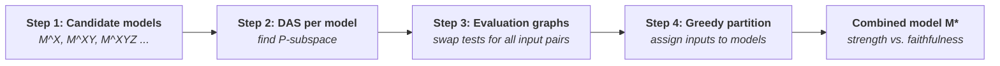
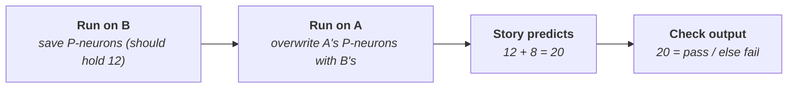
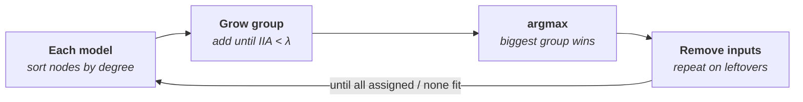
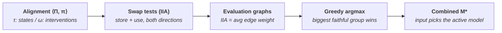

---
The core idea
- A single high-level algorithm is often only a **partially faithful** abstraction of a network (e.g. 70% IIA) — and partial scores are hard to interpret.
- Fix: **combine several simple causal models**, where the **input decides which model is "active"** → the network is described as being in different computational states for different inputs.
- ==Trade-off made explicit: **strength** (how many inputs get a non-trivial explanation) vs. **faithfulness** (IIA).==

Setup
- GPT-2 small, fine-tuned on two toy tasks: **arithmetic** ($X+Y+Z$, values 1–10 → 1000 inputs) and **boolean logic** (64 inputs).
- Alignment via **DAS** (pyvene), 256-dim subspaces of the residual stream.

---
#### Constructive Causal Abstraction — Alignment, τ and ω

> _"An alignment ⟨Π, π⟩ assigns each high-level variable $X \in \mathbf{V}_\mathcal{H}$ a partition cell $\Pi_X \subseteq \mathbf{V}_\mathcal{L}$ of low-level variables and a function $\pi_X$ for determining the value of $X$ from a setting of $\Pi_X$. From an alignment, we can construct a map $\tau^\pi$ from low-level total settings $\mathbf{v}_\mathcal{L}$ to high-level total settings... We can also construct a map $\omega^\pi$ from low-level hard interventions to high-level hard interventions..."_

The big picture
- Two descriptions of the same computation:
    - **$\mathcal{L}$ (low-level)** = the neural network (tokens, neurons, outputs).
    - **$\mathcal{H}$ (high-level)** = a simple algorithm (e.g. "compute $P = X+Y$, then $O = P+Z$").
- Need two **translators** between them:
    1. **τ** → translates **states** ("network is in this state ⇒ algorithm is in that state").
    2. **ω** → translates **interventions** ("this neuron edit ⇒ that algorithm edit").
- Both are built from one ingredient: the **alignment ⟨Π, π⟩**.

Toy example used throughout
- **$\mathcal{L}$:** input tokens `x, y, z` → hidden neurons `h1, h2, h3` → output neuron `o`
- **$\mathcal{H}$** ($\mathcal{M}^{XY}$): $X, Y, Z \to P = X+Y \to O = P+Z$

---
###### 1️⃣ The Alignment ⟨Π, π⟩ — "which neurons hold which variable, and how to read them"

|High-level variable|**Π** = which low-level variables hold it|**π** = how to read its value|
|:--|:--|:--|
|X|{`x`}|the token's number|
|Y|{`y`}|the token's number|
|Z|{`z`}|the token's number|
|**P**|**{`h1`, `h2`}**|**$\pi_P(h_1, h_2) = h_1 + h_2$**|
|O|{`o`}|the predicted number|

- **$\Pi_X$** = a "partition cell" — a group of neurons. Groups don't overlap → each neuron belongs to **at most one** high-level variable. (`h3` belongs to nothing — irrelevant machinery.)
- **$\pi_X$** = the **decoder** that turns those neurons' values into the high-level value.
- ==🟢Analogy: **Π** tells you _which drawer_ the info is stored in; **π** tells you _how to read the note_ inside the drawer.==
---
###### 2️⃣ τ — Translating a full network state into a full algorithm state

$$\tau^\pi(\mathbf{v}_\mathcal{L}) = \bigcup_{X_\mathcal{H}\in \mathbf{V}_\mathcal{H}} \pi_{X_\mathcal{H}}\big(\text{Proj}_{\Pi_{X_\mathcal{H}}}(\mathbf{v}_\mathcal{L})\big)$$

Read right → left:

|Piece|Meaning|
|:--|:--|
|**$\mathbf{v}_\mathcal{L}$**|"total setting" — snapshot of **every** low-level variable's value|
|**$\text{Proj}_{\Pi_X}(\mathbf{v}_\mathcal{L})$**|zoom in on just the neurons in X's drawer|
|**$\pi_X(\dots)$**|decode those values into a value for X|
|**$\bigcup$ over all X**|do this for every high-level variable → collect into one high-level snapshot|

Worked example
- Network snapshot: `x=4, y=2, z=8, h1=5, h2=1, h3=−3, o=14`
- X ← `x` = **4** | Y ← `y` = **2** | Z ← `z` = **8** | P ← `h1+h2` = 5+1 = **6** | O ← `o` = **14** | (`h3` ignored)
- → τ gives **{X=4, Y=2, Z=8, P=6, O=14}**

<mark style="background: #FF5582A6;">Typo in the paper</mark>
- Text says "values for the low-level variables $\pi_{X_\mathcal{H}}$" → should be **$\Pi_{X_\mathcal{H}}$** (the cell of neurons, not the decoder).
---
###### 3️⃣ ω — Translating a neuron edit into an algorithm edit

$$\omega^\pi(\mathbf{x}_\mathcal{L}) = \mathbf{x}_\mathcal{H} \iff \tau^\pi\big(\text{Proj}^{-1}_{\mathbf{V}_\mathcal{L}}(\mathbf{x}_\mathcal{L})\big) = \text{Proj}^{-1}_{\mathbf{V}_\mathcal{H}}(\mathbf{x}_\mathcal{H})$$

- Question it answers: ==**"If I force some neurons to fixed values, which high-level variable did I just set, and to what?"**==
- **$\mathbf{x}_\mathcal{L}$** = a _partial_ setting (e.g. "h1 = 4, h2 = 7") = a hard intervention.
- **$\text{Proj}^{-1}(\mathbf{x}_\mathcal{L})$** ("inverse projection") = **set of all full snapshots consistent with it** — h1 = 4, h2 = 7, everything else free.
- Same on the right: **$\text{Proj}^{-1}(\mathbf{x}_\mathcal{H})$** = all algorithm states where $\mathbf{x}_\mathcal{H}$ holds.
- **The rule:** translate every compatible network state with τ. If the result is **exactly** "all algorithm states where $\mathbf{x}_\mathcal{H}$ holds" → the neuron edit _means_ $\mathbf{x}_\mathcal{H}$.

|Case|Intervention|What happens|Result|
|:--|:--|:--|:--|
|✅ **Works**|`h1 = 4, h2 = 7`|every compatible state has P = **11**; X, Y, Z, O still free|**ω = do(P = 11)**|
|❌ **Fails**|only `h1 = 4`|`h2` free → P = 4 + h2 could be many values|**ω undefined** — you only "half-set" P|

- ==🔴Intuition: a low-level edit maps to a high-level edit only if it **fully pins down** some high-level variables and **leaves the others completely free**.==
---
###### 4️⃣ Why bother? — Exact transformation

$$\tau\big(\mathcal{L}_{\mathbf{i}}(b)\big) = \mathcal{H}_{\omega(\mathbf{i})}\big(\delta(b)\big)$$

- Two routes must agree:
    - 🅰️ Edit neurons → run network → translate result with τ
    - 🅱️ Translate edit with ω → run algorithm with that edit
- Agree for every input + every intervention ⇒ ==**$\mathcal{H}$ is a constructive abstraction of $\mathcal{L}$** — the network really implements the algorithm.==
- The interchange-intervention example (Appendix C.2) = exactly this test in action: set network's P-neurons to values from another input (P = 11 instead of 6) → does it output 19 as the algorithm predicts?

One-line summary

|Symbol|Plain meaning|
|:--|:--|
|**$\Pi_X$**|which neurons store X|
|**$\pi_X$**|how to read X off those neurons|
|**τ**|network snapshot → algorithm snapshot|
|**ω**|neuron edit → algorithm edit (only when it cleanly sets whole variables)|

---
#### Short Summary — Both Equations (Symbols + Interpretation)
Equation 1 — τ (translating states)

|Symbol|Meaning|
|:--|:--|
|**$\mathcal{L}$ / $\mathcal{H}$**|low-level model (network) / high-level model (algorithm)|
|**$\mathbf{v}_\mathcal{L}$**|full snapshot: value of every low-level variable|
|**$\mathbf{V}_\mathcal{H}$**|set of all high-level variables (X, Y, Z, P, O)|
|**$X_\mathcal{H}$**|one high-level variable|
|**$\Pi_{X_\mathcal{H}}$**|the group of neurons assigned to $X_\mathcal{H}$|
|**$\text{Proj}_{\Pi}(\mathbf{v}_\mathcal{L})$**|keep only the values of those neurons|
|**$\pi_{X_\mathcal{H}}$**|decoder: neuron values → value of $X_\mathcal{H}$|
|**$\bigcup$**|collect results for all variables into one snapshot|
|**$\tau^\pi$**|network snapshot → algorithm snapshot|

- ==🟢Interpretation: for each high-level variable, look at its neurons and decode them → put all answers together = the algorithm's state.==

Equation 2 — ω (translating interventions)

|Symbol|Meaning|
|:--|:--|
|**$\mathbf{x}_\mathcal{L}$**|low-level intervention: fix _some_ neurons|
|**$\mathbf{x}_\mathcal{H}$**|high-level intervention: fix _some_ algorithm variables|
|**$\text{Proj}^{-1}_{\mathbf{V}_\mathcal{L}}(\mathbf{x}_\mathcal{L})$**|all network snapshots consistent with $\mathbf{x}_\mathcal{L}$ (others free)|
|**$\text{Proj}^{-1}_{\mathbf{V}_\mathcal{H}}(\mathbf{x}_\mathcal{H})$**|all algorithm snapshots consistent with $\mathbf{x}_\mathcal{H}$|
|**$\tau^\pi(\dots)$**|translate every snapshot in that set|
|**$\iff$**|"is defined as exactly when"|
|**$\omega^\pi$**|neuron edit → algorithm edit|

- ==🟢Interpretation: a neuron edit **means** $\mathbf{x}_\mathcal{H}$ if translating every compatible network state gives **exactly** the algorithm states where $\mathbf{x}_\mathcal{H}$ holds — fully fixes those variables, leaves all others free.==

One-line takeaway

- **τ:** "What state is the algorithm in, given the network's state?"
- **ω:** "Which algorithm edit does this neuron edit correspond to?" — only defined when the edit cleanly sets whole high-level variables.
---
#### $\mathcal{M}^X, \mathcal{M}^Y, \mathcal{M}^Z$ — "Intermediate variable P representing the processed input"

> _"To localize each variable, we define models $\mathcal{M}^X, \mathcal{M}^Y, \mathcal{M}^Z$ with intermediate variable P representing the processed input and O representing the output: $\mathcal{M}^X$: $F_P(X) = X$, $F_O(P, Y, Z) = P + Y + Z$"_

Short definition
- A tiny algorithm with **one extra middle step P that just copies one input**.
- **$\mathcal{M}^X$:** $P = X$ (unchanged) → $O = P + Y + Z$ (output uses P in place of X).
- $\mathcal{M}^Y$, $\mathcal{M}^Z$ — same, P copies Y or Z.

Why add a variable that just copies X?
- Because ==**P is the thing you search for inside the network**==.
- Hypothesis $\mathcal{M}^X$: _"Somewhere in this layer, the network stores X on its own, not yet added to anything."_
- **"Processed input"** = the network's **internal representation** of X (vs. the raw token X).
- ==🟢Analogy: X = the number written on paper; P = the number held in your head after reading it, before doing any adding.==

How it's tested (concrete)
1. **Base:** 4 + 2 + 8 → 14 | **Source:** 7 + 5 + 1
2. Copy the suspected P-neurons from the source run into the base run → swaps X from 4 to 7.
3. $\mathcal{M}^X$ predicts 7 + 2 + 8 = **17**.
4. Network outputs 17 → those neurons really store X ✅

Where it fits

|Model|What P holds|Claim about the layer|
|:--|:--|:--|
|$\mathcal{M}^X, \mathcal{M}^Y, \mathcal{M}^Z$|one input alone|"nothing added yet"|
|$\mathcal{M}^{XY}, \mathcal{M}^{YZ}, \mathcal{M}^{XZ}$|sum of two inputs|"partial sum exists"|
|$\mathcal{M}^{XYZ}$|full sum|"already finished" (trivial model)|

- **Figure 1:** $\mathcal{M}^X, \mathcal{M}^Y, \mathcal{M}^Z$ high in early layers (inputs still separate), drop in later layers (inputs mixed into sums).
---
#### "Largest Subset Where Abstraction Holds Perfectly" — The Early-Work Approach

> _"Early work attempted to avoid this issue by identifying the largest subset of the input space for which abstraction relation holds perfectly (Geiger et al., 2020, 2021). This specific evaluation was too rigid, as a single failed interchange intervention results in total failure."_

The problem it responds to
- An algorithm matches the network **70%** of the time — what do you conclude?
    - "Mostly works"?  Or "wrong explanation, matching by luck"? 
- ==🔴Partial scores are **hard to interpret**.==

The early solution
- Don't score on **all** inputs → find the **biggest group of inputs where the algorithm matches 100%** (zero mistakes).
- Clean claim: ✅ _"On these inputs, the network definitely runs this algorithm"_ — say nothing about the rest.
- ==🟢Analogy: student gets 70% overall → instead say _"they got every fraction question right."_ Smaller claim, but fully trustworthy.==

Concrete (arithmetic task)
- 1000 inputs; $\mathcal{M}^{XY}$ matches 70% overall.
- Early method finds e.g. **400 inputs** where **every** interchange intervention among them works → "For these 400, the network computes X + Y first."

Why "too rigid"
- Demands **perfection** — a **single failed** intervention breaks the subset → guaranteed region can shrink a lot.

What this paper does instead
- Keeps the idea (assign inputs to the explanation that fits them), but loosens it:
    - **Faithfulness threshold λ** (e.g. 95% instead of 100%)
    - **Several models**, each covering its own group of inputs

---
#### Definition 1 — Combined Causal Models $\mathcal{M}^*$

> *"The intermediate variables of $\mathcal{M}^\ast$ are the union of all intermediate variables $\mathbf{V}^\ast = \bigcup_{j=1}^k \mathbf{V}_j$ and the mechanism for $X \in \mathbf{V}^\ast$ is $F^\ast_X(\mathbf{v}^\ast) = F^j_X(\text{Proj}_{\mathbf{V}_j}(\mathbf{v}^\ast))$ if $\text{Proj}_{\mathbf{X}_{In}}(\mathbf{v}^\ast) \in \Delta_j$, $\varnothing$ otherwise... If an input $x$ is in partition $\Delta_j$, then the variables $\mathbf{V}_j$ are activated and the variables from other models are set to a null value $\varnothing$."*

The idea in one sentence
- ==**$\mathcal{M}^*$ = several small algorithms glued together; the input decides which one is "switched on".**==

1️⃣ Union of intermediate variables
- $\mathbf{V}^* = \bigcup_j \mathbf{V}_j$ → put **all middle variables from all models** into one big model.
- e.g. combining $\mathcal{M}^{XY}, \mathcal{M}^{YZ}, \mathcal{M}^{XYZ}$ → $\mathbf{V}^* = {P_{XY}, P_{YZ}, P_{XYZ}}$

2️⃣ The mechanism (main equation)

$$
F^\ast_X(\mathbf{v}^\ast) = \begin{cases} F^j_X\big(\text{Proj}_{\mathbf{V}_j}(\mathbf{v}^\ast)\big) & \text{if } \text{Proj}_{\mathbf{X}_{In}}(\mathbf{v}^\ast) \in \Delta_j \\ \varnothing & \text{otherwise} \end{cases}
$$

|Symbol|Meaning|
|:--|:--|
|**$X \in \mathbf{V}^*$**|one intermediate variable of the combined model|
|**$\mathbf{v}^*$**|full snapshot of all variables in $\mathcal{M}^*$|
|**$F^*_X$**|rule for computing X in the combined model|
|**$F^j_X$**|X's original rule from model $\mathcal{M}^j$|
|**$\text{Proj}_{\mathbf{V}_j}(\mathbf{v}^*)$**|keep only values model $\mathcal{M}^j$ cares about|
|**$\text{Proj}_{\mathbf{X}_{In}}(\mathbf{v}^*)$**|look only at the input (x, y, z)|
|**$\Delta_j$**|the group of inputs assigned to $\mathcal{M}^j$|
|**$\varnothing$**|"null" — off, no value|

How to read it

- Input belongs to $\mathcal{M}^j$'s group $\Delta_j$ → compute X with $\mathcal{M}^j$'s normal rule.
- Otherwise → X = $\varnothing$.
- ==For any input, **exactly one model's variables are active**; all others are $\varnothing$.==
- **"Piecewise"** = the rule changes depending on which region of inputs you're in (like a piecewise function).

Worked example (from the paper)
- $\Delta_1$: X ≤ 3 → **$\mathcal{M}^{XY}$** | $\Delta_2$: 3 < X ≤ 6 → **$\mathcal{M}^{YZ}$** | $\Delta_3$: X > 6 → **$\mathcal{M}^{XYZ}$**

|Input|Group|$P_{XY}$|$P_{YZ}$|$P_{XYZ}$|O|
|:--|:--|:--|:--|:--|:--|
|(2, 5, 4)|$\Delta_1$|2+5 = **7** ✅|∅|∅|7+4 = **11**|
|(8, 1, 1)|$\Delta_3$|∅|∅|8+1+1 = **10** ✅|**10**|

Why do this?
- ==🔴The network probably **doesn't use one strategy for every input**== → $\mathcal{M}^*$ lets you say "for these inputs it computes X + Y first, for those it does something else" → **more faithful** than forcing one model onto all inputs.
---
#### Figure 2 — Strength vs. Faithfulness (Arithmetic, Layer 7)

The axes

|Axis|Meaning|Plain words|
|:--|:--|:--|
|**x-axis** (0.80 → 1.00)|**Faithfulness threshold λ**|"How accurate must the explanation be?" (1.00 = no mistakes)|
|**y-axis** (0 → 100)|**Strength**|"What % of inputs can be explained at that accuracy?"|

- Each **line** = one explanation: single model (e.g. XY) or combination (e.g. X+XY).

> _"Definition 2 (Model Strength): ... the strength of $\mathcal{M}^\ast$ is the proportion of inputs not assigned to the trivial model $1 - \frac{|\Delta_k|}{|Val_{\mathbf{X}_{In}}|}$."

Why every line goes down
- Moving right = demanding more accuracy → stricter standard → fewer inputs qualify.
- 🟢Analogy: "students scoring ≥ 80%" = many; "students scoring 100%" = few.

Main pattern — combined lines sit on top (Panel a, approx.)

|Model|λ = 0.8|λ = 0.9|λ = 0.95|λ = 1.0|
|:--|:--|:--|:--|:--|
|X alone|~60%|~20%|~8%|~5%|
|Y alone|~72%|~20%|~8%|~6%|
|XY alone|~100%|~81%|~50%|~12%|
|**X+XY / Y+XY**|**~100%**|**~84%**|**~55%**|**~18%**|

- Panels **(b)** and **(c)** → same story for Y/Z and X/Z.
- **Panel (d)** — cyan line = all six combined (X+Y+Z+XY+XZ+YZ):
    - λ = 1.0 → explains **~38%** perfectly vs. best single model **~13%** → ==🟢roughly **3× stronger** at perfect faithfulness==

At λ = 0.8
- Good models and combinations all reach ~**100%** — allowing 20% mistakes is loose enough that one model "fits" everything → combining stops mattering.
- (Weak single models like X alone still sit lower, ~60–70%.)

One-line takeaway
- ==**If you want an explanation you can really trust, mixing several simple models explains far more inputs than any one alone.**==
---
#### Single Model vs. Combined Model — "X" vs. "X + YZ"

> _"What's the difference between a model with only X vs a model with X + YZ for example?"_

1️⃣ Model "X" alone ($\mathcal{M}^X$)
- **One story:** "the network stores X by itself here."
- Inputs where the story **doesn't fit** → **trivial model** = "no explanation" 🤷.

2️⃣ Model "X + YZ" (combined)
- **Two stories, each input gets whichever fits:**
    - some inputs → "stores X by itself" ($\mathcal{M}^X$)
    - other inputs → "already computed Y + Z" ($\mathcal{M}^{YZ}$)
- Only inputs fitting **neither** → trivial model.

Toy example (10 inputs)
- $\mathcal{M}^X$ works for **1, 2, 3** | $\mathcal{M}^{YZ}$ works for **4, 5, 6, 7** | **8, 9, 10** fit neither

|Explanation|Inputs explained|Strength|
|:--|:--|:--|
|X alone|1, 2, 3|**30%**|
|YZ alone|4, 5, 6, 7|**40%**|
|**X + YZ**|1–7|**70%** ✅|

- ==🟢The combined model **doesn't need one story to explain everything** — each story covers the inputs it's good at.==
- Analogy: two doctors — one for kids, one for adults. Each alone treats only part of the patients; a clinic with both treats far more.
- Note: "X + YZ" isn't its own line in Fig. 2 — panels show pairs like **Y + YZ**, **Z + YZ**, and (d) combines all six. Same idea.
---
#### Evaluation Graphs

> _"We precompute the interchange intervention accuracies for each model $\mathcal{M}^1, \dots, \mathcal{M}^{k-1}$ in the form of evaluation graphs... the nodes are inputs, meaning there are 1000 nodes... For inputs (x, y, z) and (x′, y′, z′), there are two interchange interventions depending on which input is the base and which is the source. The edge in $G^j$ is weighted 0, 0.5, or 1... $\mathcal{M}^j$ is a perfect abstraction of a neural network when its corresponding evaluation graph $G^j$ is a complete graph where all edges have weight 1."_

The goal first
- Decide **which inputs go to which model** (the groups $\Delta_1, \Delta_2, \dots$).
- Need to know: **"For which inputs does $\mathcal{M}^j$ actually work?"**
- ==Evaluation graph = a **lookup table of test results**, drawn as a graph.==
- Why only up to **$\Delta_{k-1}$**? $\mathcal{M}^k$ = trivial "no explanation" model → want to give it as few inputs as possible.

How it's built (one graph per model)

|Graph part|What it is|
|:--|:--|
|**Node** 🔵|one input, e.g. (3, 5, 2) → 10 × 10 × 10 = **1000** nodes|
|**Edge** ➖|test result between two inputs|

Edge weights (two swap tests per pair: A→B and B→A)

|Result|Weight|
|:--|:--|
|both pass ✅✅|**1**|
|one passes ✅❌|**0.5**|
|both fail ❌❌|**0** (no edge)|

Tiny example — $\mathcal{M}^{XY}$, 4 inputs

|Pair|Tests|Weight|
|:--|:--|:--|
|A–B|✅✅|1|
|A–C|✅❌|0.5|
|B–C|✅✅|1|
|A–D, B–D, C–D|❌❌|0|

- A, B, C well connected → $\mathcal{M}^{XY}$ works on them | D isolated → needs another model

"Complete graph with all weights 1"
- **Every** pair passes **both** tests → **perfect abstraction**.

Why a graph at all?
- ==🔴**IIA of any group of inputs = average edge weight inside that group.**==
- → "find a big group where the model is accurate" = **"find a big, densely connected cluster of nodes"**.
- Tests run **once in advance** ("precompute") → greedy algorithm just reads the graphs, no re-running the network.
$$IIA_{G^k} = \frac{2 \sum_{(i,j)\in E} w(i,j)}{|V|(|V|-1)}$$
---
###### Why 1000 Nodes? What Is the Test? What's the Point?_

What we're trying to achieve
- Network solves $X+Y+Z$ perfectly, but we **don't know how** inside.
- We have a story, e.g. $\mathcal{M}^{XY}$: _"it first computes X + Y, stores it, then adds Z."_
- Can't just read neurons and see "11" → need an **experiment**. That experiment = the test.

Why 1000 nodes
- X, Y, Z ∈ {1, …, 10} → 10 × 10 × 10 = **1000 different prompts**.
- ==Each prompt = one node. That's all a node is: one possible question for the network.==

The test — a "swap" experiment
- Earlier (via DAS) we found neurons we **think** store X + Y → the **P-neurons**.
- **A = 4 + 2 + 8** (X+Y = 6, answer 14) | **B = 3 + 9 + 7** (X+Y = 12, answer 19)

- Then the other way round (B as base, A as source) → prediction 6 + 7 = **13**.
- → **two tests per pair** → edge weight 1 / 0.5 / 0.

Why does this prove anything?
- ==🔴If swapping those neurons changes the answer **exactly** as the story predicts, the neurons must really carry X + Y and the network must really use it== — a random swap wouldn't produce exactly 20.

What's the graph for?
- Story may be **true for some inputs, false for others** → swap-test **every pair** → record as graph.
- Look for **clusters where tests pass** → those inputs get assigned to this story.

One-line takeaway
- ==**Swap suspected neurons between two inputs, check if the output changes as the story predicts, repeat for all pairs → map out where the story is true.**==
---
###### Why Swap in Both Directions?

> _"Why do we need to do the swap in both directions between 2 inputs? Why isn't doing it once enough?"_

Short answer

- ==**The two swaps are two different experiments — they can give different results.**==

|Direction|What gets tested|Story predicts|
|:--|:--|:--|
|**B → A** (A is base)|put "11" into A's run, keep Z = 8|11 + 8 = **19**|
|**A → B** (B is base)|put "6" into B's run, keep Z = 7|6 + 7 = **13**|

- Different questions: "11" with Z = 8 vs. "6" with Z = 7 → network might get one ✅ and the other ❌ (e.g. P-neurons store large sums cleanly but small ones messily, or the swap interferes with a particular Z).
- 🟢Analogy: Alice may do Bob's job fine 👍 while Bob can't do Alice's 👎 → try both ways.
- Graph has **one edge per pair** → edge must summarize both experiments. One direction = **half the evidence**.
- Bonus: IIA is defined over **all (base, source) pairs** (order matters) → testing both directions makes average edge weight **match IIA exactly**.

---

###### Why Do Swaps Tell Us Which Inputs a Model Handles?
<mark style="background: #FF5582A6;">The key problem: you can't test one input by itself</mark>
- Run network on A = 4 + 2 + 8 → **14**. But **every** story predicts 14:
    - $\mathcal{M}^X$ → 14 | $\mathcal{M}^{XY}$ → 14 | $\mathcal{M}^{XYZ}$ → 14
- ==🔴Normal outputs **can't tell stories apart** — they all agree on normal runs.==
- Only way to distinguish them = **mess with the inside** → need a **different value to put in** → it has to come from **another input**.
- 👉 That's why every test involves **two inputs**.

Each input plays two roles

|Role|Question it answers|
|:--|:--|
|📤 **As source** (we take its P-neurons)|Does this input's run **store** X + Y correctly?|
|📥 **As base** (we put values into it)|Does this input's run **use** those neurons to compute the answer?|

- A as source → give A's values to B → B's answer becomes 6 + 7 = 13? → A really **stored** "6" ✅
- A as base → put B's values into A → A's answer becomes 11 + 8 = 19? → A really **reads** from those neurons ✅
- ==For the story to describe A, **both** must hold: A stores X + Y _and_ uses it → why both directions.==

How this decides assignment
- Test A against **many** other inputs:
    - ✅ mostly succeed → story describes A well → **assign A to this model**
    - ❌ mostly fail → network does something else on A → **try another model**
- Input with **many strong edges** = one the story explains well → why the greedy algorithm sorts nodes by degree.

One-line takeaway
- ==**Normal outputs can't distinguish stories → swap internal values between inputs. An input fits a story if it both stores and uses the story's variable correctly → tested as source and as base.**==

Connects to:
- ==🔴[[Symmetry in Localization (Get/Set Consistency)]] — same "store/get vs. use/set" duality. Testing each input in **both roles** is the evaluation-side version of HyperDAS's get/set consistency requirement.==
---
#### The Greedy Partitioning Algorithm

> _"First, for each candidate model $\mathcal{M}^j$, we greedily identify the largest possible set of currently unassigned inputs on which $\mathcal{M}^j$ achieves the faithfulness threshold λ. 1. The nodes of $G^j$ are sorted from highest degree to lowest degree. 2. Nodes are added to a subgraph $S^j$ until the next node would result in an interchange intervention accuracy... that exceeds λ. 3. The best model is $\mathcal{M}^j$ where $j = \text{argmax}_j(|S^j|)$ is assigned input space $\Delta_j$... Then, the nodes from $S^j$ are removed from the graph, and we repeat..."_

Goal
- Hand out inputs to models so **as many inputs as possible** get a real explanation, while each model stays **≥ λ accurate** on its inputs.

The steps
1. **Sort by degree** — degree = how strongly a node is connected (how many swap tests involving it passed). High degree → story fits well → tried first.
2. **Build a group one at a time** — add inputs in order; after each, check group accuracy (avg. edge weight). Still ≥ λ ---> keep going | would drop **below** λ ---> stop.
3. **Compare models, pick winner** — do 1–2 for **every** model → **biggest group wins** → becomes its $\Delta_j$.
4. **Remove and repeat** — delete assigned inputs from all graphs.
5. **Stop when** every input is assigned, **or** no model can form a group meeting λ → leftovers → **trivial model**.

<mark style="background: #FF5582A6;">Typo in the paper</mark>
- Says "**exceeds** λ" → means "**falls below** λ".

Toy example — 8 inputs, models A and B, λ = 0.9

|Round|Model A's best group|Model B's best group|Winner|
|:--|:--|:--|:--|
|1|{1, 2, 3, 4, 5} → 5|{1, 6, 7} → 3|**A** takes 1–5|
|2 (left: 6, 7, 8)|{6} → 1|{6, 7} → 2|**B** takes 6, 7|
|3 (left: 8)|nothing|nothing|🛑 stop|

- Result: $\Delta_A$ = {1–5}, $\Delta_B$ = {6, 7}, input 8 → trivial → **Strength = 7/8 = 87.5%** at 90% faithfulness.

Why "greedy"?
- ==🟡Takes the **best-looking choice right now**, without planning ahead → fast, but not guaranteed to find the perfect split.==
---
###### The argmax Step — "Pick the Winner"

> _"The best model is $\mathcal{M}^j$ where $j = \text{argmax}_j(|S^j|)$ is assigned input space $\Delta_j$ corresponding to the nodes of subgraph $S^j$."_

|Symbol|Meaning|
|:--|:--|
|**$S^j$**|group of inputs model $\mathcal{M}^j$ found in the previous step|
|**$\lvert S^j \rvert$**|its size|
|**$\text{argmax}_j$**|"which j gives the biggest value?"|
|**$\Delta_j$**|inputs officially given to $\mathcal{M}^j$|

- Plain words: ==**"Look at every model's group, find the biggest, give those inputs to that model."**==

| Model              | Its group $S^j$ | Size  |
| :----------------- | :-------------- | :---- |
| $\mathcal{M}^X$    | {1, 4}          | 2     |
| $\mathcal{M}^{XY}$ | {1, 2, 3, 5, 6} | **5** |
| $\mathcal{M}^{YZ}$ | {2, 7, 8}       | 3     |

- argmax → 5 → **$\mathcal{M}^{XY}$** wins → **$\Delta_{XY}$ = {1, 2, 3, 5, 6}** ✅
- Other models get **nothing this round** — their groups were only "offers".

Why only the winner?
- ==🔴Groups **overlap** (input 1 in both $\mathcal{M}^X$'s and $\mathcal{M}^{XY}$'s; input 2 in $\mathcal{M}^{XY}$'s and $\mathcal{M}^{YZ}$'s) — an input can't belong to two models.==
- Winner's inputs removed → remaining models compete again next round.
---
#### Figure 3b — The De Morgan Strategy (Boolean Task)

The task $$OP_1\big(,OP_2(X);;B;;OP_3(Y),\big)$$

- **X, Y** ∈ {True, False} | **$OP_1, OP_2, OP_3$** ∈ {**¬**, **I**} | **B** ∈ {**∧**, **∨**}

Two strategies

| Step   | 3a — "inside first, then outside" | 3b — "push the outer NOT inward"         |
| :----- | :-------------------------------- | :--------------------------------------- |
| Step 1 | $X' = OP_2(X)$, $Y' = OP_3(Y)$    | $V = OP_1(OP_2(X))$, $W = OP_1(OP_3(Y))$ |
| Step 2 | $Q = X' \; B \; Y'$               | $B' = OP_1(B)$ (if ¬: AND ↔ OR flip)     |
| Step 3 | $O = OP_1(Q)$                     | $O = V \; B' \; W$                       |

- **De Morgan's law:** $\neg(A \wedge B) = \neg A \vee \neg B$ → "NOT of an AND" = "an OR of NOTs".
- ==🔴Same answer, **different intermediate steps** → exactly what swap tests can tell apart: does the network store **Q** (3a) or **V, W, B′** (3b)?==

Reading the diagram
- **Bottom:** inputs | **Middle:** V, B′, W (each = OP₁ + one piece) | **Top:** O | arrows = "computed from"
- Key visual difference: ==in **3b, OP₁ feeds into the middle variables**; in 3a it only acts at the very end.==
---
#### Figure 4 — Which Story Fits at Which Layer (Boolean Task)

|Axis|Meaning|
|:--|:--|
|**x-axis**|GPT-2 layer, 0 → 11|
|**y-axis**|**IIA** — how often swap tests pass|
|**each line**|one story ($\mathcal{M}^X, \mathcal{M}^Q, \mathcal{M}^V, \dots$), one intermediate variable each|

- Same type of plot as **Figure 1**, but for boolean logic.
- ==**Most layers: every story fits → nothing can be concluded. Layer 10 = first where they differ → worth analyzing. Layer 11: only the final answer remains.**==

Connects to:
- [[Faithfulness Concern — "Interpreting vs. Editing"]] — layers 0–9 are a clean example of a large, flexible subspace making **every** hypothesis pass. High IIA ≠ found the real mechanism.
---
#### Figure 5 — Combining Stories on the Boolean Task (Layer 10)

Same setup as Fig. 2
- **x-axis:** required accuracy λ | **y-axis:** strength (% of 64 inputs explained) | higher = better ⬆️
How the 6 panels are organized — one **"built" variable** vs. **the pieces it's made from**

|Panel|Built variable|Made from|
|:--|:--|:--|
|(a)|$X' = OP_2(X)$|OP₂, X|
|(b)|$Y' = OP_3(Y)$|OP₃, Y|
|(c)|$V = OP_1(OP_2(X))$|OP₁, OP₂, X|
|(d)|$W = OP_1(OP_3(Y))$|OP₁, OP₃, Y|
|(e)|$Q = X' ,B, Y'$|OP₂, OP₃, X, Y, B|
|(f)|$B' = OP_1(B)$|OP₁, B|

- **Single lines** ("X", "X′") = one story alone | **"+" lines** ("X+X′") = combined: some inputs use the piece story, others the built story.
- ==🟢Why pair them: at layer 10, the network may still hold the **raw piece** for some inputs and the **already-built value** for others → a combination captures both.==

Main result — "+" lines on top (approx., λ = 1.0)

|Panel|Best single story|Best combination|
|:--|:--|:--|
|(a) X′|~50%|**~75%** (OP₂+X′)|
|(c) V|<50%|**~88%** (OP₂+V)|
|(e) Q|~50%|**~90%** (X+Q, OP₂+Q)|
|(f) B′|~50%|**~84%** (OP₁+B′)|

- ==At perfect faithfulness, combining often explains **far more** inputs — sometimes nearly **2×**.==

At λ = 0.8
- **Every** line → **100%** — too loose to make a difference (same as Fig. 2).

vs. Figure 2
- Same conclusion on a **different task** with only **64 inputs** (vs. 1000) → method isn't a one-off arithmetic trick.

One-line takeaway
- ==**At high accuracy, mixing "network still has the raw piece" with "network already built the combined value" explains many more inputs than either story alone.**==
---
#### Synthesis — How It All Fits Together

| Concept                      | One-line meaning                                               |
| :--------------------------- | :------------------------------------------------------------- |
| **Alignment**                | which neurons hold which variable + how to decode them         |
| **τ / ω**                    | translate states / interventions between network and algorithm |
| **$\mathcal{M}^X$ etc.**     | "P holds X alone" — a probe for where X lives                  |
| **Interchange intervention** | swap P-neurons between inputs, check prediction                |
| **Evaluation graph**         | nodes = inputs, edges = swap-test results                      |
| **Greedy partition**         | each round, largest faithful group wins                        |
| **$\mathcal{M}^*$**          | piecewise model — input decides which story is active          |
| **Strength**                 | % of inputs not sent to the trivial model                      |
| **Faithfulness**             | IIA on the assigned inputs (threshold λ)                       |

Some things that came to mind while I read this paper:
- ==🔴Combining models raises strength — but each extra model and partition adds flexibility. At the extreme, a per-input partition is a gerrymandered $M^*$ that fits every glitch.==
- Connects to ==🟢Ideal Models, Glitchy Implementations & Misrepresentation== (clean $M$ vs. overfitted $M^*$, MDL) and ==🟢The Triviality Specter & Sutter et al. (2025)'s Theorem== — the strength/faithfulness curve doesn't by itself tell you ==🔵when a combination stops being explanation and starts being curve-fitting.==
- ==Relevance to thesis: another case where metric success (IIA + strength) ≠ guaranteed genuine mechanism.==
